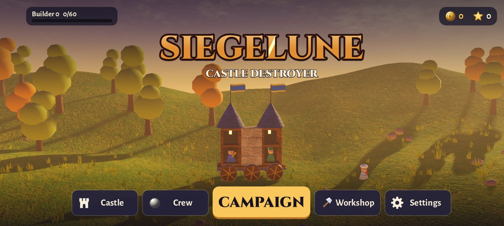
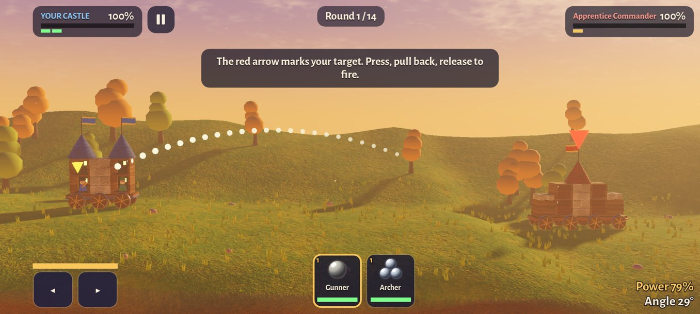
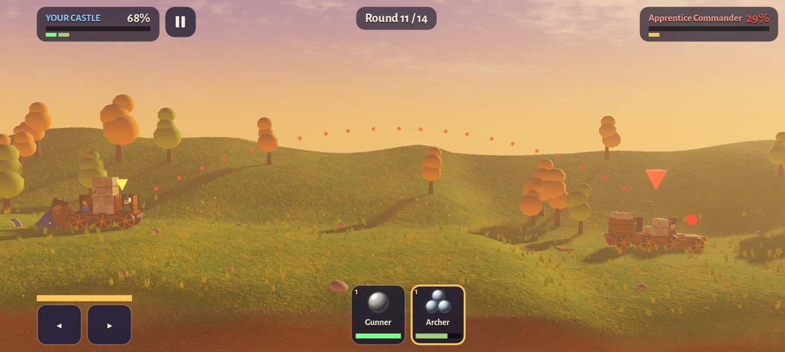
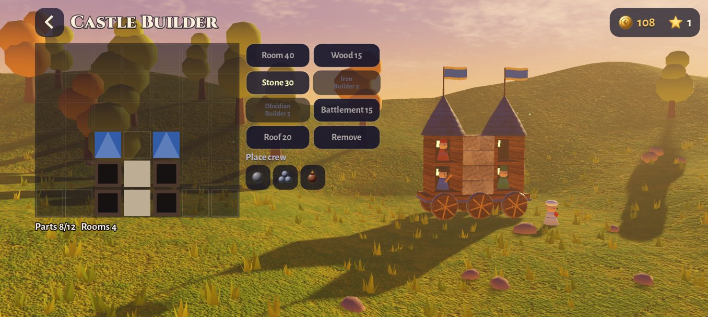
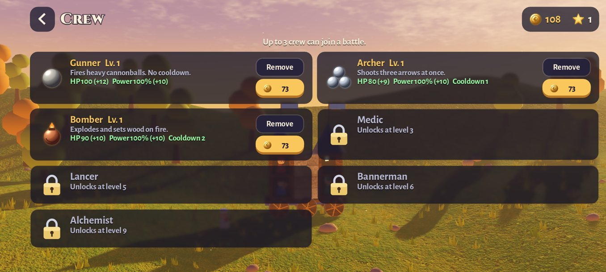
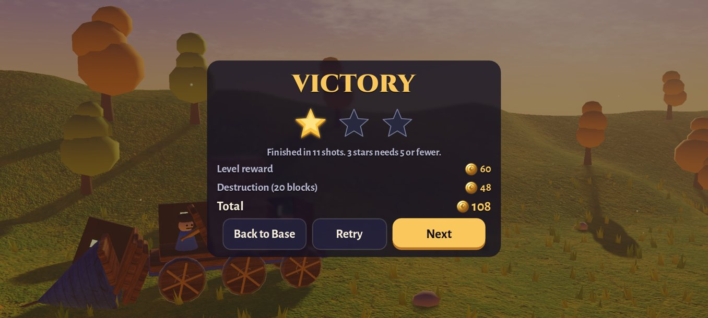

# Siegelune: Castle Destroyer

A 3D siege game for Android: build a castle on wheels, put your crew inside and bring down the enemy's walls. Plays offline.

[Türkçe](#türkçe) · [Privacy policy](privacy.md)

  
  
  

  
  
  

Home base · Aiming · Battle · Castle Builder · Crew · Victory

## Download

- **Android:** coming to Google Play.

## Features

- **Siege battles:** take turns with an AI rival. Press, pull back and release to fire. The enemy castle stays in view while you aim, and a red trail shows your last shot so you can adjust.
- **Real destruction:** walls, roofs and rooms break apart with physics. A room that loses its pillars collapses on whoever is inside, and fire spreads across wood.
- **Your castle, your design:** in the Castle Builder, place rooms, wood, stone, iron, obsidian, battlements and roofs, then choose which room each crew member takes. In battle, drive your castle on its wheels to change your angle.
- **Seven kinds of crew:** Gunner, Archer, Bomber, Medic, Lancer, Bannerman and Alchemist, each with their own shot or skill. Level them up and improve your castle with five Workshop upgrades.
- **12 levels in 3 worlds:** Golden Slopes, Glacier Peaks and Ember Storm, up to the Last Castle. Then the Trophy Trail: endless duels against AI rivals across a series of arenas.
- **Made for phones:** Battery Saver or High graphics. Plays offline, and progress is saved on your phone. English and Turkish; the game follows your phone's language and you can change it in Settings.

The game is free and contains ads: an occasional full-screen ad between battles. Rewarded ads are optional and give extra gold. A one-time "Remove Ads" purchase removes the full-screen ads.

## Support

passlune.app@gmail.com

Built with Godot Engine, Jolt Physics, Poing Godot AdMob and Godot Google Play Billing (MIT license). Fonts: Cinzel and Alegreya Sans (SIL Open Font License 1.1). All models, textures, sounds and music were generated in code for this game.

This repository holds the documentation only; the source code is not published here.

---

## Türkçe

Android için 3D kuşatma oyunu: tekerlekli kaleni kur, birliğini içine yerleştir, düşmanın surlarını yerle bir et. İnternetsiz oynanır.

[Gizlilik politikası](privacy.md#türkçe)

Ekran görüntüleri (yukarıda): Üs · Nişan alma · Savaş · Kale Tezgâhı · Birlikler · Zafer

### İndir

- **Android:** yakında Google Play'de.

### Özellikler

- **Kuşatma savaşları:** yapay zekâ rakibinle sırayla oyna. Bas, geriye çek, bırakınca ateş et. Nişan alırken düşman kalesi hep görünür, kırmızı iz önceki atışını gösterir ve nişanını düzeltmeni sağlar.
- **Gerçek yıkım:** duvarlar, çatılar ve odalar fizikle parçalanır. Sütunu giden oda içindekinin üstüne yıkılır, ateş ahşap boyunca yayılır.
- **Kaleni sen tasarla:** Kale Tezgâhı'nda oda, ahşap, taş, demir, obsidyen, mazgal ve çatı yerleştir, her birliğin hangi odada duracağını seç. Savaşta kaleni tekerlekleriyle sürerek açını değiştir.
- **Yedi çeşit birlik:** Topçu, Okçu, Humbaracı, Hekim, Mızrakçı, Bayraktar ve Simyacı; her birinin kendi atışı ya da yeteneği var. Seviyelerini yükselt, kaleni Atölye'deki beş geliştirmeyle güçlendir.
- **3 dünyada 12 bölüm:** Altın Yamaçlar, Buzul Zirveler ve Kor Fırtınası, Son Kale'ye kadar. Ardından Kupa Yolu: arena arena yapay zekâ rakiplerle bitmeyen düellolar.
- **Telefonlar için:** Pil Dostu ya da Yüksek grafik. İnternetsiz oynanır, ilerlemen telefonunda saklanır. Türkçe ve İngilizce; oyun telefonunun dilini izler, Ayarlar'dan değiştirebilirsin.

Oyun ücretsizdir ve reklam içerir: savaş aralarında seyrek bir tam ekran reklam. Ödüllü reklamlar isteğe bağlıdır ve ek altın verir. Tek seferlik "Reklamları Kaldır" satın alımı tam ekran reklamları kaldırır.

### Destek

passlune.app@gmail.com

Godot Engine, Jolt Physics, Poing Godot AdMob ve Godot Google Play Billing ile yapıldı (MIT lisansı). Yazı tipleri: Cinzel ve Alegreya Sans (SIL Open Font License 1.1). Bütün modeller, dokular, sesler ve müzik bu oyun için kodla üretildi.

Bu depoda yalnızca belgeler bulunur; kaynak kod burada yayımlanmaz.
